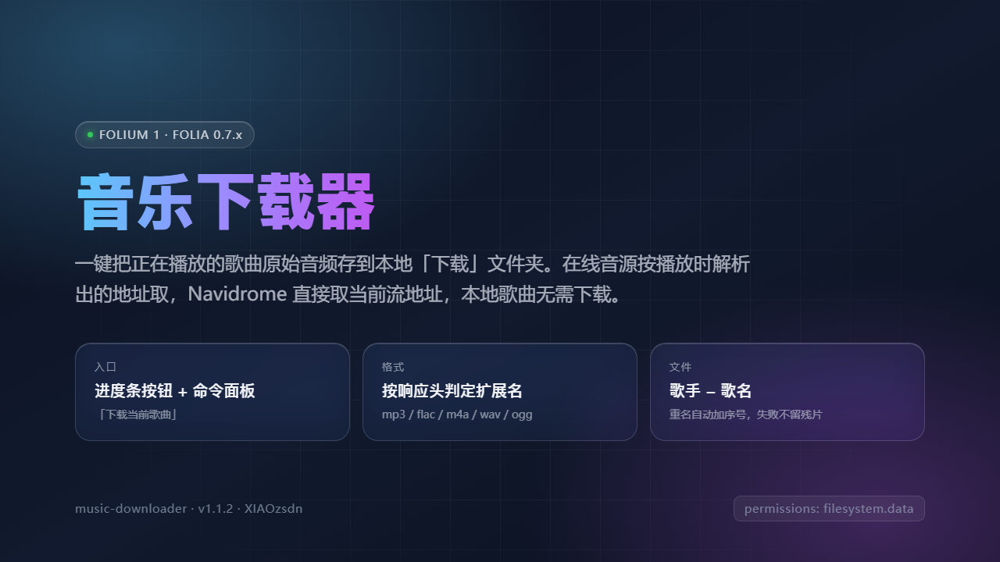

# 音乐下载器

> Folia 模组 · Folium 1 · `music-downloader` · v1.1.2

把**当前正在播放**的歌曲原始音频下载到系统「下载」文件夹。在线音源（网易云、酷狗等）使用播放时解析出的音频地址，Navidrome 使用播放器当前的流地址；本地歌曲的文件本来就在磁盘上，不需要下载。



## 用法

两种入口，共用同一段下载逻辑：

1. **进度条按钮** —— 播放进度条右侧的下载图标，点一下即下载当前歌曲；
2. **命令面板** —— 搜索「下载当前歌曲」执行。

下载完成后会返回保存路径；文件名格式为 `歌手 - 歌名.ext`，重名自动加序号。

## 行为细节

| 项目 | 说明 |
| --- | --- |
| 扩展名 | 按响应的 `Content-Type` 判定（mp3 / flac / m4a / wav / ogg 等），比猜 URL 后缀可靠 |
| 写入方式 | 先写 `.part` 临时文件，校验通过后再改名；任一步失败都会删掉临时文件，不留半个文件 |
| 重定向 | 最多跟随 5 次 |
| 超时 | 建连 30 秒；下载途中空闲超过 30 秒即中止 |
| 歌曲身份 | 只认当前播放的这首歌——宿主会预解析下一首，所以不会把下一首的地址当成当前歌曲 |

## 安装

1. 在 Folia 的「设置 → 系统 → 模组」里打开模组系统；
2. 把本模组目录（或打包好的 zip）放进模组的安装入口；
3. 启用时核对确认窗口里的签名与权限。

## 权限

| 权限 | 为什么需要 |
| --- | --- |
| `filesystem.data` | main 入口通过 `api.storage.paths` / `api.storage` 读写本模组自己的数据；下载目标为系统下载目录 |

实验接口：

| 接口 | 为什么需要 |
| --- | --- |
| `omni.hooks` | 监听 Omni 解析在线音频地址的事件（`omni.audioSourceResolved`），拿到可下载的 https 地址 |

## 兼容

- `folia`: `>=0.7.20 <0.8.0`
- 只有 `main` 与 `client` 两个入口，无第三方依赖、无构建步骤。

## 目录

```
music-downloader/
├── mod.json      清单
├── client.mjs    渲染端：注册进度条按钮与命令，跟踪当前歌曲
├── index.cjs     主进程：流式下载、校验、命名、落盘
└── preview.png   介绍图（1280×720）
```

## 许可证

MIT，见 [LICENSE](LICENSE)。
